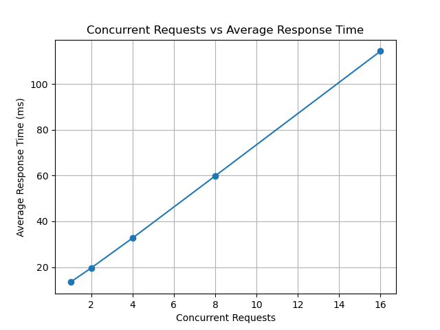
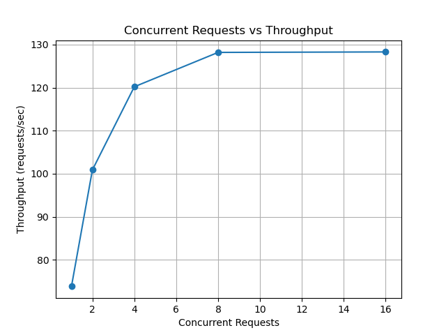
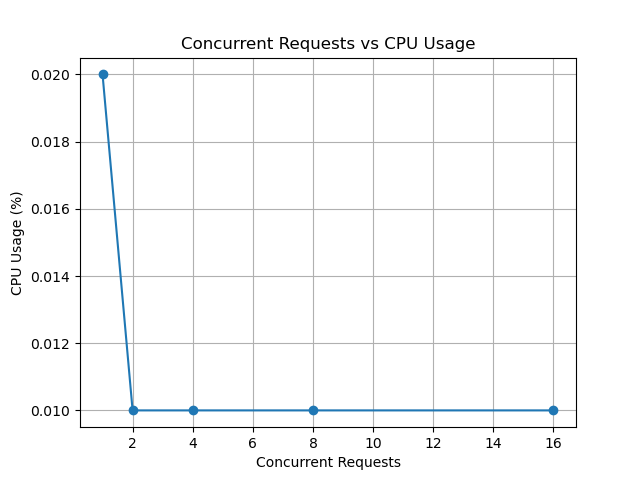
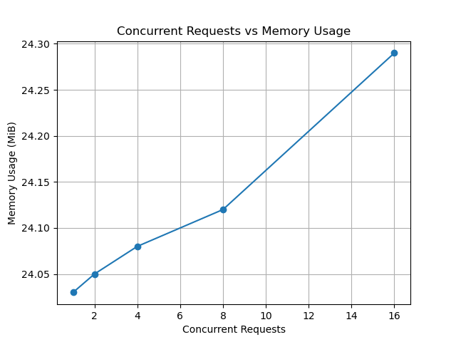
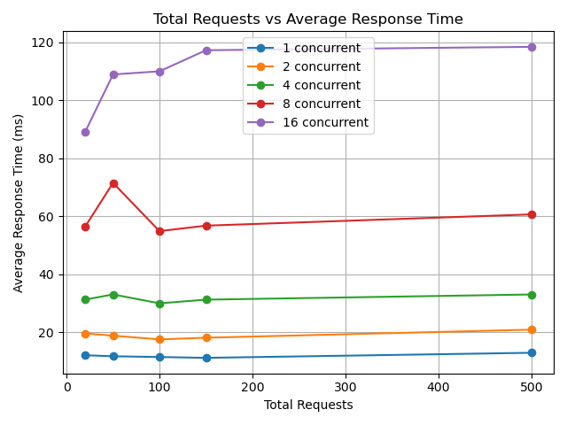
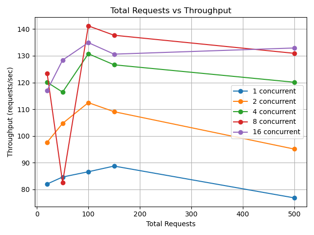
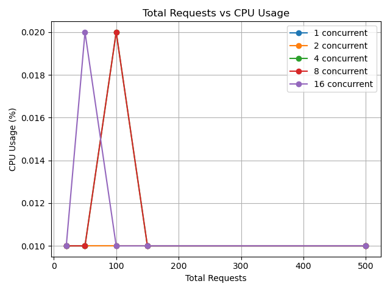
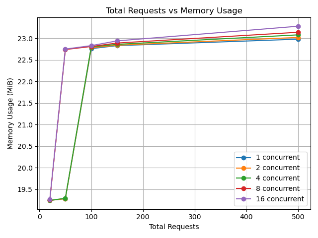

# Satellite Monitoring Platform

## 1. Project Overview

The **Satellite Monitoring Platform** is a containerized microservice application developed using **Flask, Docker, and Docker Compose**.

The application contains three independent microservices:

- **Satellite Service** – receives satellite monitoring requests.
- **Image Service** – processes satellite image requests.
- **Analysis Service** – analyzes image changes and generates alert information.

The services communicate through a shared Docker network.

---

## 2. Architecture

```text
Client
   |
   v
Satellite Service
   |
   v
Image Service
   |
   v
Analysis Service
   |
   v
Analysis + Alert
```

| Service | Port | Main Function |
|---|---:|---|
| Satellite Service | 5000 | Handles satellite and monitoring requests |
| Image Service | 5001 | Processes satellite images |
| Analysis Service | 5002 | Performs analysis and generates alerts |

The complete request flow is:

```text
Client
  ↓
Satellite Service
  ↓
Image Service
  ↓
Analysis Service
  ↓
Analysis + Alert Result
```

---

# 3. Folder Structure

```text
satellite-monitoring/
│
├── satellite-service/
│   ├── app.py
│   ├── requirements.txt
│   └── Dockerfile
│
├── image-service/
│   ├── app.py
│   ├── requirements.txt
│   └── Dockerfile
│
├── analysis-service/
│   ├── app.py
│   ├── requirements.txt
│   └── Dockerfile
│
├── workload/
│   ├── workload_test.py
│   ├── compare_requests.py
│   ├── response_time.png
│   ├── throughput.png
│   ├── cpu_usage.png
│   ├── memory_usage.png
│   ├── comparison_response_time.png
│   ├── comparison_throughput.png
│   ├── comparison_cpu.png
│   └── comparison_memory.png
│
└── docker-compose.yml
```

---

# 4. Requirements

The project uses:

- Ubuntu Linux
- Python 3
- Flask
- Requests
- Docker
- Docker Compose
- Matplotlib

---

# 5. Microservices

## 5.1 Satellite Service

**Service name:** `satellite-service`

**Port:** `5000`

The Satellite Service receives monitoring requests and communicates with the Image Service.

### Files

```text
satellite-service/
├── app.py
├── requirements.txt
└── Dockerfile
```

### app.py

```python
from flask import Flask, jsonify, request
import uuid
from datetime import datetime
import requests

app = Flask(__name__)

@app.route("/")
def home():
    return jsonify({
        "service": "Satellite Service",
        "status": "running"
    })

@app.route("/satellites", methods=["GET"])
def get_satellites():
    satellites = [
        {"satellite_id": "SAT-001", "name": "EarthWatch-1", "status": "active"},
        {"satellite_id": "SAT-002", "name": "EarthWatch-2", "status": "active"},
        {"satellite_id": "SAT-003", "name": "EarthWatch-3", "status": "maintenance"}
    ]
    return jsonify(satellites)

@app.route("/request-image", methods=["POST"])
def request_image():
    data = request.get_json()
    satellite_id = data.get("satellite_id", "SAT-001")
    location = data.get("location", "Unknown")

    image_id = "IMG-" + str(uuid.uuid4())[:8]

    response = {
        "image_id": image_id,
        "satellite_id": satellite_id,
        "location": location,
        "timestamp": datetime.utcnow().isoformat(),
        "status": "requested"
    }

    return jsonify(response), 201

@app.route("/monitor", methods=["POST"])
def monitor():
    data = request.get_json()
    satellite_id = data.get("satellite_id", "SAT-001")
    location = data.get("location", "Unknown")

    image_response = requests.post(
        "http://image-service:5001/images",
        json={
            "satellite_id": satellite_id,
            "location": location
        }
    )

    image_result = image_response.json()

    return jsonify({
        "satellite_id": satellite_id,
        "location": location,
        "image_processing": image_result
    }), image_response.status_code

if __name__ == "__main__":
    app.run(host="0.0.0.0", port=5000)
```

### requirements.txt

```text
Flask
requests
```

### Dockerfile

```dockerfile
FROM python:3.10-slim

WORKDIR /app

COPY requirements.txt .

RUN pip install --no-cache-dir -r requirements.txt

COPY app.py .

EXPOSE 5000

CMD ["python", "app.py"]
```

---

## 5.2 Image Service

**Service name:** `image-service`

**Port:** `5001`

The Image Service processes satellite image requests and sends the processed image information to the Analysis Service.

### Files

```text
image-service/
├── app.py
├── requirements.txt
└── Dockerfile
```

### app.py

```python
from flask import Flask, jsonify, request
import uuid
from datetime import datetime
import random
import requests

app = Flask(__name__)

@app.route("/")
def home():
    return jsonify({
        "service": "Image Service",
        "status": "running"
    })

@app.route("/images", methods=["POST"])
def create_image():
    data = request.get_json()
    satellite_id = data.get("satellite_id", "SAT-001")
    location = data.get("location", "Unknown")

    image_id = "IMG-" + str(uuid.uuid4())[:8]
    change_percentage = round(random.uniform(5, 40), 2)

    image = {
        "image_id": image_id,
        "satellite_id": satellite_id,
        "location": location,
        "timestamp": datetime.utcnow().isoformat(),
        "change_percentage": change_percentage,
        "status": "processed"
    }

    analysis_response = requests.post(
        "http://analysis-service:5002/analyze",
        json={
            "image_id": image_id,
            "change_percentage": change_percentage
        }
    )

    analysis_result = analysis_response.json()
    image["analysis"] = analysis_result

    return jsonify(image), 201

@app.route("/health")
def health():
    return jsonify({
        "service": "Image Service",
        "status": "healthy"
    })

if __name__ == "__main__":
    app.run(host="0.0.0.0", port=5001)
```

### requirements.txt

```text
Flask
requests
```

### Dockerfile

```dockerfile
FROM python:3.10-slim

WORKDIR /app

COPY requirements.txt .

RUN pip install --no-cache-dir -r requirements.txt

COPY app.py .

EXPOSE 5001

CMD ["python", "app.py"]
```

---

## 5.3 Analysis Service

**Service name:** `analysis-service`

**Port:** `5002`

The Analysis Service evaluates the percentage of image change and generates risk and alert information.

### Files

```text
analysis-service/
├── app.py
├── requirements.txt
└── Dockerfile
```

### app.py

```python
from flask import Flask, jsonify, request
from datetime import datetime

app = Flask(__name__)

@app.route("/")
def home():
    return jsonify({
        "service": "Analysis Service",
        "status": "running"
    })

@app.route("/analyze", methods=["POST"])
def analyze_image():
    data = request.get_json()
    image_id = data.get("image_id", "IMG-UNKNOWN")
    change_percentage = float(data.get("change_percentage", 0))

    if change_percentage >= 30:
        analysis_result = "significant_change"
        risk_level = "high"
        alert_status = "critical_alert_generated"
        message = "Significant change detected."

    elif change_percentage >= 15:
        analysis_result = "moderate_change"
        risk_level = "medium"
        alert_status = "warning_generated"
        message = "Moderate change detected."

    else:
        analysis_result = "minor_change"
        risk_level = "low"
        alert_status = "no_alert"
        message = "Minor change detected."

    alert_result = {
        "alert_status": alert_status,
        "image_id": image_id,
        "risk_level": risk_level,
        "analysis_result": analysis_result,
        "message": message,
        "created_at": datetime.utcnow().isoformat()
    }

    result = {
        "image_id": image_id,
        "change_percentage": change_percentage,
        "analysis_result": analysis_result,
        "risk_level": risk_level,
        "analyzed_at": datetime.utcnow().isoformat(),
        "alert": alert_result
    }

    return jsonify(result), 200

@app.route("/health")
def health():
    return jsonify({
        "service": "Analysis Service",
        "status": "healthy"
    })

if __name__ == "__main__":
    app.run(host="0.0.0.0", port=5002)
```

### requirements.txt

```text
Flask
```

### Dockerfile

```dockerfile
FROM python:3.10-slim

WORKDIR /app

COPY requirements.txt .

RUN pip install --no-cache-dir -r requirements.txt

COPY app.py .

EXPOSE 5002

CMD ["python", "app.py"]
```

---

# 6. Docker Compose

Docker Compose is used to run the three services together.

### docker-compose.yml

```yaml
version: '3.8'

services:

  satellite-service:
    image: satellite-service:1.0
    container_name: satellite-container
    ports:
      - "5000:5000"
    networks:
      - satellite-network

  image-service:
    image: image-service:1.0
    container_name: image-container
    ports:
      - "5001:5001"
    networks:
      - satellite-network

  analysis-service:
    image: analysis-service:1.0
    container_name: analysis-container
    ports:
      - "5002:5002"
    networks:
      - satellite-network

networks:
  satellite-network:
    driver: bridge
```

The services communicate using their Docker service names:

```text
image-service:5001
analysis-service:5002
```

---

# 7. Building the Docker Images

Each service is built into a separate Docker image.

From the project root:

```bash
cd ~/Desktop/satellite-monitoring
```

### Build Satellite Service

```bash
docker build -t satellite-service:1.0 ./satellite-service
```

### Build Image Service

```bash
docker build -t image-service:1.0 ./image-service
```

### Build Analysis Service

```bash
docker build -t analysis-service:1.0 ./analysis-service
```

### Check images

```bash
docker images
```

The following images should be available:

```text
satellite-service:1.0
image-service:1.0
analysis-service:1.0
```

---

# 8. Starting the Application

Start all three services using Docker Compose:

```bash
docker-compose up -d
```

The `-d` option runs the containers in the background.

### Check container status

```bash
docker-compose ps
```

Expected containers:

```text
satellite-container
image-container
analysis-container
```

### Check running containers

```bash
docker ps
```

### View logs

```bash
docker-compose logs
```

Individual service logs can also be viewed:

```bash
docker-compose logs satellite-service
docker-compose logs image-service
docker-compose logs analysis-service
```

### Stop the application

```bash
docker-compose down
```

### Rebuild and restart

If the source code or Dockerfiles are changed:

```bash
docker-compose down

docker build -t satellite-service:1.0 ./satellite-service
docker build -t image-service:1.0 ./image-service
docker build -t analysis-service:1.0 ./analysis-service

docker-compose up -d
```

---

# 9. API Testing

## Satellite Service

### Service status

```bash
curl http://localhost:5000/
```

### Get satellites

```bash
curl http://localhost:5000/satellites
```

### Request an image

```bash
curl -X POST http://localhost:5000/request-image \
-H "Content-Type: application/json" \
-d '{"satellite_id":"SAT-001","location":"Karnataka"}'
```

---

## Image Service

### Service status

```bash
curl http://localhost:5001/
```

### Health check

```bash
curl http://localhost:5001/health
```

### Create image

```bash
curl -X POST http://localhost:5001/images \
-H "Content-Type: application/json" \
-d '{"satellite_id":"SAT-001","location":"Karnataka"}'
```

---

## Analysis Service

### Service status

```bash
curl http://localhost:5002/
```

### Health check

```bash
curl http://localhost:5002/health
```

### Analyze an image

```bash
curl -X POST http://localhost:5002/analyze \
-H "Content-Type: application/json" \
-d '{"image_id":"IMG-12345678","change_percentage":35}'
```

---

# 10. End-to-End Testing

The complete service workflow was tested through the Satellite Service:

```bash
curl -X POST http://localhost:5000/monitor \
-H "Content-Type: application/json" \
-d '{"satellite_id":"SAT-001","location":"Karnataka"}'
```

The request travels through all three services:

```text
Client
   ↓
Satellite Service :5000
   ↓
Image Service :5001
   ↓
Analysis Service :5002
   ↓
Analysis + Alert
```

The end-to-end request completed successfully.

---

# 11. Workload Testing

Workload testing was performed using:

```text
workload/workload_test.py
```

The workload generator sends requests to:

```text
http://localhost:5000/monitor
```

The concurrency levels used were:

```text
1, 2, 4, 8, 16
```

The following metrics were recorded:

- Average Response Time
- Throughput
- CPU Usage
- Memory Usage
- Failed Requests

Docker resource usage was monitored using:

```bash
docker stats
```

The workload test also generated graphs for response time, throughput, CPU usage, and memory usage.

---

# 12. Concurrency Experiment

For the first experiment, the total number of requests was fixed at:

```text
100 requests
```

The concurrency level was varied:

```text
1 → 2 → 4 → 8 → 16
```

## Results

| Concurrent Requests | Total Requests | Successful | Failed | Avg Response Time (ms) | Throughput (req/s) | CPU (%) | Memory (MiB) |
|---:|---:|---:|---:|---:|---:|---:|---:|
| 1 | 100 | 100 | 0 | 13.44 | 73.84 | 0.02 | 24.03 |
| 2 | 100 | 100 | 0 | 19.64 | 100.89 | 0.01 | 24.05 |
| 4 | 100 | 100 | 0 | 32.70 | 120.19 | 0.01 | 24.08 |
| 8 | 100 | 100 | 0 | 59.85 | 128.17 | 0.01 | 24.12 |
| 16 | 100 | 100 | 0 | 114.38 | 128.28 | 0.01 | 24.29 |

## Generated Graphs

### Response Time



### Throughput



### CPU Usage



### Memory Usage



---

# 13. Request-Volume Comparison

A second experiment was performed to compare different total request volumes.

The tested request volumes were:

```text
20 → 50 → 100 → 150 → 500
```

For each request volume, the following concurrency levels were tested:

```text
1, 2, 4, 8, 16
```

The comparison graphs were generated using:

```text
workload/compare_requests.py
```

The request volume of **250 was not included** because that workload was not run during the experiment.

---

# 14. Comparison Graphs

### Total Requests vs Average Response Time



### Total Requests vs Throughput



### Total Requests vs CPU Usage



### Total Requests vs Memory Usage



---

# 15. Request-Volume Results

| Total Requests | Concurrency | Avg Response (ms) | Throughput (req/s) | CPU (%) | Memory (MiB) | Failed |
|---:|---:|---:|---:|---:|---:|---:|
| 20 | 1 | 12.05 | 82.00 | 0.01 | 19.24 | 0 |
| 20 | 2 | 19.57 | 97.63 | 0.01 | 19.24 | 0 |
| 20 | 4 | 31.25 | 120.09 | 0.01 | 19.24 | 0 |
| 20 | 8 | 56.43 | 123.38 | 0.01 | 19.25 | 0 |
| 20 | 16 | 89.09 | 117.06 | 0.01 | 19.27 | 0 |
| 50 | 1 | 11.70 | 84.61 | 0.01 | 19.28 | 0 |
| 50 | 2 | 18.81 | 104.68 | 0.01 | 19.28 | 0 |
| 50 | 4 | 33.03 | 116.40 | 0.01 | 19.29 | 0 |
| 50 | 8 | 71.52 | 82.59 | 0.01 | 22.74 | 0 |
| 50 | 16 | 108.95 | 128.39 | 0.02 | 22.75 | 0 |
| 100 | 1 | 11.44 | 86.58 | 0.01 | 22.76 | 0 |
| 100 | 2 | 17.52 | 112.46 | 0.01 | 22.78 | 0 |
| 100 | 4 | 29.96 | 130.77 | 0.02 | 22.80 | 0 |
| 100 | 8 | 54.88 | 141.20 | 0.02 | 22.81 | 0 |
| 100 | 16 | 110.04 | 134.94 | 0.01 | 22.83 | 0 |
| 150 | 1 | 11.15 | 88.71 | 0.01 | 22.83 | 0 |
| 150 | 2 | 18.10 | 109.07 | 0.01 | 22.84 | 0 |
| 150 | 4 | 31.23 | 126.63 | 0.01 | 22.86 | 0 |
| 150 | 8 | 56.77 | 137.70 | 0.01 | 22.89 | 0 |
| 150 | 16 | 117.31 | 130.62 | 0.01 | 22.94 | 0 |
| 500 | 1 | 12.90 | 76.80 | 0.01 | 22.98 | 0 |
| 500 | 2 | 20.88 | 95.08 | 0.01 | 23.02 | 0 |
| 500 | 4 | 33.02 | 120.10 | 0.01 | 23.08 | 0 |
| 500 | 8 | 60.66 | 130.93 | 0.01 | 23.14 | 0 |
| 500 | 16 | 118.48 | 132.93 | 0.01 | 23.28 | 0 |

All requests in the tested workloads were successful, with **0 failed requests**.

---

# 16. Analysis

The workload experiments produced the following observations:

- Increasing concurrency generally increased average response time.
- Throughput increased initially with concurrency and then showed variation at higher concurrency levels.
- CPU usage remained very low during the experiments, around `0.01–0.02%` in the recorded Docker statistics.
- Memory usage showed a gradual increase as workload increased.
- All tested requests completed successfully.
- No failed requests were recorded in the experiments.

> **Note:** CPU and memory values represent Docker Stats snapshots recorded during the workload tests and should not be interpreted as continuous average resource utilization.

---

# 17. Main Docker Commands

| Purpose | Command |
|---|---|
| Build Satellite image | `docker build -t satellite-service:1.0 ./satellite-service` |
| Build Image image | `docker build -t image-service:1.0 ./image-service` |
| Build Analysis image | `docker build -t analysis-service:1.0 ./analysis-service` |
| Check images | `docker images` |
| Start all services | `docker-compose up -d` |
| Check Compose containers | `docker-compose ps` |
| Check running containers | `docker ps` |
| View logs | `docker-compose logs` |
| Monitor CPU and memory | `docker stats` |
| Stop services | `docker-compose down` |
| Remove orphan containers | `docker-compose down --remove-orphans` |

---

# 18. Conclusion

The **Satellite Monitoring Platform** successfully implements a three-service containerized architecture using **Flask, Docker, and Docker Compose**.

The Satellite Service, Image Service, and Analysis Service communicate through a shared Docker network and provide a complete monitoring workflow from satellite request to image processing, analysis, and alert generation.

The workload experiments evaluated the effect of different concurrency levels and request volumes on response time, throughput, CPU usage, and memory usage.

All tested workloads completed successfully with **zero failed requests**.
